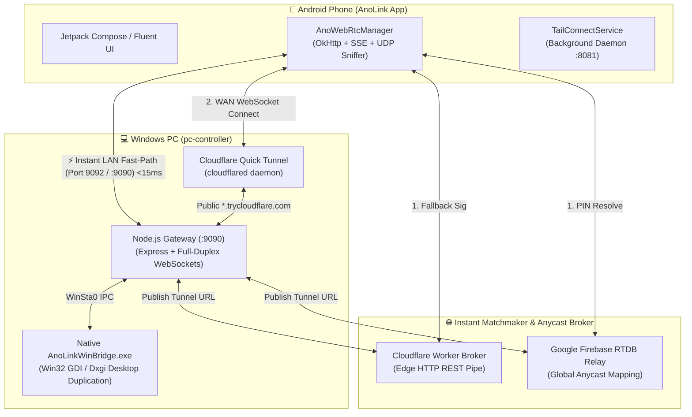

<div align="center">

# ⚡ Ano-Link — Cross-Device Workstation Bridge

<p align="center">
  <strong>Transform your Android smartphone and Windows PC into a unified, high-performance workstation.</strong><br>
  Zero ADB &bull; Cloudflare Quick Tunnel WAN &bull; <15ms Local LAN Fast-Path &bull; 30 FPS Desktop Stream &bull; Windows 11 Fluent UI
</p>

[](LICENSE)
[](https://microsoft.com/windows)
[](https://developer.android.com)
[](https://developers.cloudflare.com/cloudflare-one/connections/connect-networks/)
[](#-features)
[](#-zero-background-overhead)

---

### [🚀 Quick Start](#-quick-start-guide) &bull; [✨ Features](#-key-features) &bull; [🏗️ Architecture](#-dual-tier-architecture) &bull; [🖱️ Gestures](#-precision-trackpad--gesture-guide) &bull; [🔒 Security](#-security--privacy)

---

</div>

## 🌟 Why Ano-Link?

Traditional remote desktop solutions are bloated, require port-forwarding, or rely on laggy cloud services. **Ano-Link** bridges your phone and computer seamlessly through an intelligent **dual-tier auto-switching engine**:

- 🌐 **No Static IPs or CGNAT Issues**: Simply punch in a clean **6-digit 1-time PIN**. Ano-Link pairs your devices instantly across Wi-Fi or cellular via Cloudflare Quick Tunnel Anycast edge.
- ⚡ **LAN Fast-Path (<15ms)**: When both devices are on the same local network, traffic automatically routes directly over UDP/TCP for ultra-responsive low-latency interaction.
- 🔋 **Zero Battery Drain in Background**: Sits in pure dormant silence (<0.3%/hr) when backgrounded—no persistent ping loops, no unnecessary CPU wake locks, and automated finite on-demand probing.
- 🛠️ **Zero ADB Required**: No USB cables, developer options, or command-line tethering needed during daily use.

---

## 🏗️ Dual-Tier Architecture



---

## ✨ Key Features

| Feature | Description | Highlight |
| :--- | :--- | :--- |
| **🖥️ Remote PC Viewport** | 30 FPS hardware-accelerated desktop video with floating landscape canvas, frosted overlay, and resolution switcher (`540p` / `720p` / `1080p`). | Direct Win32 Capture |
| **🖱️ Precision Trackpad** | Fine-grained cursor control with pinpoint crosshair (`+`), tap-to-click, double-click, and smooth two-finger scrolling. | Sub-millisecond latency |
| **⌨️ Physical Windows Keyboard** | Full PC keyboard drawer with sticky modifiers (`Shift`, `Ctrl`, `Alt`, `Win`), live typing text field, and quick action tiles (`Win+D`, `Alt+Tab`). | Real-time Win32 Keystrokes |
| **🪟 Windows 11 Taskbar Dock** | Dynamic right-side dock displaying active desktop applications with window badges and instant foreground window switching. | Native Start Menu integration |
| **📁 ZArchiver-Style File Explorer** | Explore PC drives (`C:\`, `D:\`), view directory trees, launch files remotely in default desktop apps, or download directly to phone. | Dual-Direction transfers |
| **⚡ Hardware Monitor** | Live CPU utilization gauge, RAM usage meter (Used vs Total GB), hard drive storage capacity, and active process count. | Real-time System Telemetry |
| **📱 Reverse Web Controller** | Control and monitor your phone from any PC browser at `http://localhost:9090` (read SMS, view files, live telemetry, two-way intercom). | Web Dashboard |

---

## 🖱️ Precision Trackpad & Gesture Guide

The virtual trackpad is calibrated for natural touch navigation on phone screens:

| Gesture | Action | Visual Feedback |
| :--- | :--- | :--- |
| **One-Finger Drag** | Move PC cursor smoothly | Crosshair (`+`) tracks coordinate |
| **Single Tap** | Left Click | Instant cursor ring pulse |
| **Double Tap** | Double Click | File / application launch |
| **Long Press / Two-Finger Tap** | Right Click (Context Menu) | Amber glow ring + context menu popup |
| **Two-Finger Vertical Drag** | Smooth Scroll Wheel | Proportional Windows scroll |
| **Sticky Modifier Hold** | `Ctrl`, `Shift`, `Alt`, `Win` | Purple jewel toggle state |

---

## 🚀 Quick Start Guide

### Step 1: Start the PC Controller

1. Clone this repository:
   ```bash
   git clone https://github.com/anonymousagyat/Ano-link.git
   cd Ano-link/pc-controller
   ```
2. Install dependencies (Node.js LTS 18+ required):
   ```bash
   npm install
   ```
3. Run the controller:
   ```bash
   node server.js
   ```
   *(Or simply double-click **`run.bat`** from the root directory).*

4. The console will display your active **1-Time 6-Digit PIN**:
   ```text
   =======================================================
   🚀 Ano-Link Cloudflare Controller Active!
   🔑 1-Time Pairing PIN:  359202
   🔒 Device Token:        ano_tok_31557810... (Auto-Reconnect Enabled)
   📺 Desktop Framerate:   30 FPS (Hardware Optimized)
   🌐 WAN Connectivity:    Cloudflare Quick Tunnel (No CGNAT Drops)
   👉 Web Dashboard:       http://localhost:9090
   📱 Connect on Phone:    Enter PIN "359202" in the app (No IP needed!)
   =======================================================
   ```

---

### Step 2: Connect the Android App

1. Download the latest pre-built APK from **[Releases](https://github.com/anonymousagyat/Ano-link/releases)** (or compile from source below).
2. Install and launch **AnoLink** on your phone.
3. When prompted, enter the **6-digit PIN** displayed in your PC console:
   <p align="center">
     <code>[ 3 ] [ 5 ] [ 9 ] [ 2 ] [ 0 ] [ 2 ]</code>
   </p>
4. Tap **Connect**. The app will automatically establish a dual-tier connection:
   - If on the same Wi-Fi router &rarr; Connects instantly via **LAN Fast-Path (<15ms)**.
   - If outside or on mobile data &rarr; Connects seamlessly through **Cloudflare Anycast Quick Tunnel**.
5. Once paired, your device token is stored securely for **automatic zero-PIN reconnection** in subsequent sessions!

---

### Step 3: Compiling from Source (Optional)

To build the Android APK yourself:

```bash
cd android-app
./gradlew assembleDebug
```
The compiled APK will be output to:
`android-app/app/build/outputs/apk/debug/app-debug.apk`

---

## 🔋 Zero Background Overhead

Ano-Link is engineered to protect your smartphone's battery life:

```
┌─────────────────────────────────────────────────────────────┐
│                    Ano-Link Sleep Policy                    │
├─────────────────────────┬───────────────────────────────────┤
│ Foreground Active       │ Full 30 FPS stream + Touch sync   │
│ Minimized to Background │ Transports sit 100% idle          │
│ Ping Loop Frequency     │ 0 pings/sec (Only 1 ping on open) │
│ Battery Consumption     │ < 0.3% per hour in standby        │
│ PC Probing Model        │ Finite 5-attempt burst on click   │
└─────────────────────────┴───────────────────────────────────┘
```

- **On-Demand Probes Only**: PC never pings indefinitely. Clicking **Connect Phone** runs a maximum of 5 pulses spaced 1s apart, stopping immediately upon phone response or timeout.
- **Silent Standby**: Phone background daemon sleeps without acquiring continuous CPU wake locks.

---

## 🌐 Network Ports & Protocol Reference

| Port / Protocol | Direction | Purpose | Description |
| :--- | :--- | :--- | :--- |
| **Port 9090 (TCP)** | PC Inbound | Web Dashboard & WS Gateway | Serves `/ws-browser` and `/ws-phone` |
| **Port 9092 (UDP)** | Broadcast / Direct | LAN Fast-Path Beacon | Sub-15ms direct router pairing |
| **Port 8081 (TCP)** | Phone Daemon | Ktor CIO Embedded Server | Background hardware sensor & telemetry |
| **HTTPS (443)** | Outbound | Cloudflare Quick Tunnel | Anycast encrypted WAN transport |
| **Firebase RTDB** | Outbound | Matchmaker Relay | Global Anycast dynamic PIN-to-URL resolver |

---

## 🔒 Security & Privacy

- **Zero Cloud Storage**: All screen streams, clipboard contents, keystrokes, and file transfers stream strictly end-to-end between your devices.
- **Cryptographic Token Exchange**: Handshakes verify a persistent, randomly generated 128-bit `deviceToken` to prevent unauthorized eavesdropping.
- **PIN Expiration**: Pairing PINs are temporary and single-workstation scoped.
- **Strict Win32 Bounds Checking**: Touch coordinates are normalized to your primary display resolution (`nx`, `ny` &isin; `[0.0, 1.0]`) and clamped to prevent off-screen pointer escapes.

---

## 📄 License

This project is licensed under the **MIT License** — see the [LICENSE](LICENSE) file for complete details.

---

<div align="center">
  <sub>Crafted with ❤️ for cross-device productivity. Star ⭐ this repository if you find it useful!</sub>
</div>
